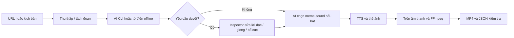

# Kiến trúc và luồng dữ liệu

## Khởi động

`run_studio.py` → `threadstudio.app.main()` → `ensure_sample_assets()` →
`AppSettings.load()` → `run_web_studio()` → aiohttp trên `127.0.0.1:8000`.

React + Tailwind được build bằng Vite từ `web/` vào `src/threadstudio/ui/web/`.
Browser gọi API Python cùng origin; backend giữ `BatchPipelineManager` và renderer Qt.
`QGuiApplication` phục vụ QImage/QPainter, không tạo cửa sổ desktop trong chế độ web.
`--desktop` giữ luồng `QApplication`/theme → `ThreadsStudioWindow` cũ.

Launcher thêm `src/` vào đường dẫn import; package cũng có entrypoint `threadstudio`.

## Luồng sản xuất

`BatchPipelineManager` giữ job trong bộ nhớ và điều phối bằng thread pool.
Các semaphore giới hạn riêng thu thập, AI, TTS và render.
Web dùng `core/database.py` để lưu settings/job/đoạn vào PostgreSQL schema `thread`.
Metadata được ghi sau thao tác và checkpoint khoảng một giây; khởi động nạp lại
job đã lưu. Job đang chạy bị gián đoạn tự tiếp tục từ checkpoint và WAV phù hợp;
dừng tay/lỗi chờ bấm Tiếp tục tạo, job chưa duyệt vẫn chờ duyệt. Xem [core](../modules/core.md).
Video/audio/ảnh vẫn là file local; DB chỉ lưu path và metadata.

URL → Edge cuộn 10 lần → đọc phản hồi mạng/JSON nhúng, fallback DOM →
xác định đúng bài gốc và nhánh trả lời → giữ pool → lọc/sort/chọn N → AI/TTS.
Inspector chọn lại từ pool sẽ quay lại chuẩn hóa, không mở trang/cuộn lại.
Đăng nhập và thu thập dùng chung profile Edge riêng, mở tuần tự để tránh khóa profile.

## Trạng thái

`queued` → `scraping` → `normalizing` → `awaiting_review` (nếu bật) →
`synthesizing` → `rendering` → `completed`.

Lỗi đi tới `failed`; yêu cầu dừng đánh dấu `cancelled`.
Hủy hiện được kiểm tra giữa các phần xử lý, không bảo đảm ngắt ngay subprocess đang chạy.
`approve_and_render` cho phép tiếp tục từ `awaiting_review` hoặc `failed`;
không đồng nghĩa tự chạy lại đầy đủ phần thu thập/AI.

## Hợp đồng dữ liệu

- `SegmentItem`: đơn vị lời đọc/thẻ; `seg_id` nối dữ liệu giữa các tầng.
- `raw_text`: nội dung gốc để hiển thị trên thẻ.
- `spoken_text`: nội dung đã chuẩn hóa hoặc do người dùng sửa để TTS đọc.
- `VideoJob`: input, đoạn nội dung, cấu hình media/layout, trạng thái và đường dẫn output.
- `LayoutConfig`: tọa độ/kích thước theo phần trăm trên khung 9:16 hoặc 16:9.
- `MediaConfig`: nguồn media, file nền riêng và Random Start/fit.
- `AppSettings`: cấu hình toàn app; không phải cơ sở dữ liệu khôi phục hàng đợi.

## Ranh giới cần giữ

- Scraper không gọi TTS hoặc render video.
- AI chuẩn hóa trả mapping `seg_id → lời đọc`; tác vụ meme riêng trả `seg_id → sound ID/null`
  sau duyệt. Không quyết định giọng hoặc điều khiển UI.
- TTS cập nhật thời lượng, đường dẫn WAV và mốc thời gian từng đoạn.
- Nếu có kế hoạch meme, pipeline tính lại mốc đoạn sau TTS để dành chỗ phát sound;
  compositor dùng kế hoạch đó để trộn, không tự chọn meme ngẫu nhiên.
- Card renderer dùng nội dung gốc; compositor dùng thẻ và âm thanh đã tạo.
- Desktop nhận Qt signal từ worker rồi mới cập nhật widget.
- Web đọc trạng thái bằng polling; AI/TTS/FFmpeg và login chạy trong worker.
  Chỉnh sửa job chỉ được nhận khi chờ duyệt/đã lỗi và không có chuẩn hóa đang chạy.

## Khi thay đổi một hành vi

Theo cả hai caller của chuẩn hóa: pipeline xử lý lô và nút chuẩn hóa lại trong Inspector.
Theo đủ bốn nơi khi đổi cấu hình: field, serialization, load và UI/caller.
Khi đổi layout, kiểm tra preview trong `stage_canvas.py` và output FFmpeg.

Xem [module core](../modules/core.md) và [lưu dữ liệu](data-storage.md).
