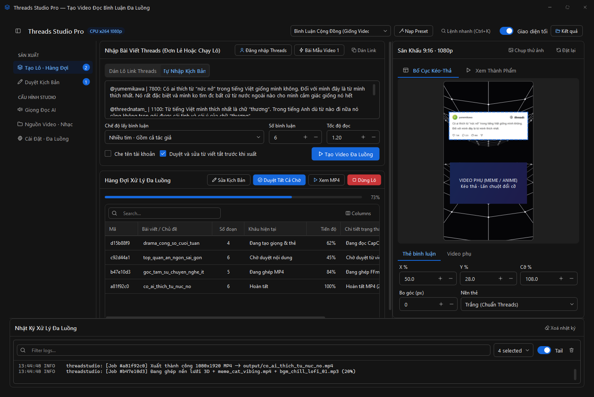
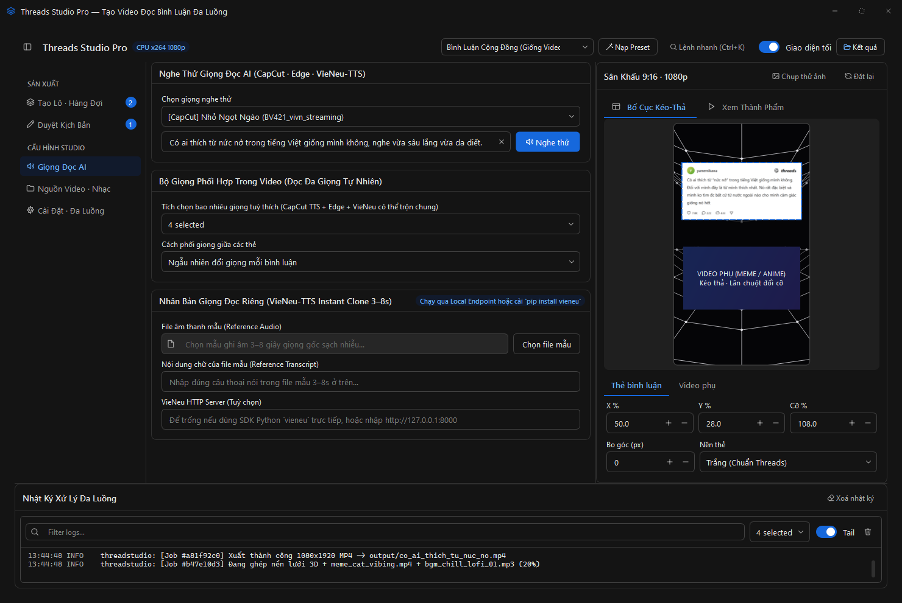
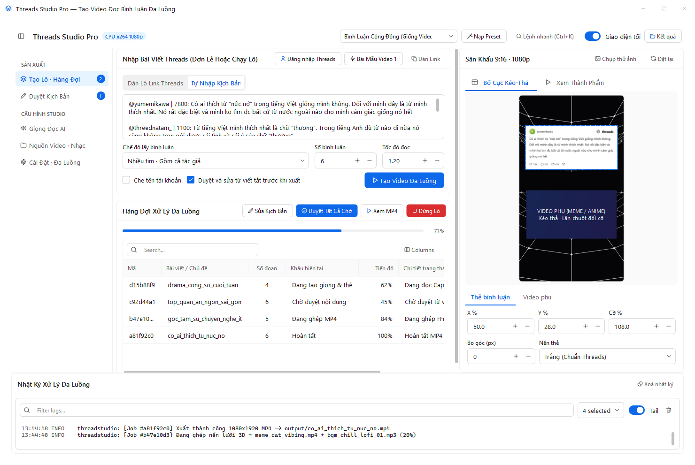

# Tính năng và giới hạn

| Tính năng hiện có | Nơi xử lý |
|---|---|
| Web local React + Tailwind, công cụ Python; UI Qt dự phòng qua `--desktop` | web/aiohttp/app |
| Trang chủ theo mẫu, hai nhóm menu riêng; thư viện video local | React |
| Route từng bước tạo video, ghi nhớ trang/job/theme và panel resize | React/History/localStorage |
| Thẻ kịch bản kéo sắp xếp, log dock dưới và token AI bên phải | React |
| PostgreSQL schema thread: cấu hình, job, kịch bản và path video | core/database, web |
| Tự tiếp tục job khi backend khởi động lại; nút tiếp tục cho job dừng/lỗi, dùng lại WAV | pipeline/TTS/web |
| Nhập lô URL hoặc kịch bản chia đoạn | UI, scraper/parser |
| Edge cuộn 10 lần, đọc JSON/DOM, lọc tác giả/spam, mặc định sort lượt thích giảm dần | scraper |
| Bảng bốn chỉ số, chọn lại top N từ pool đã tải | Inspector/pipeline |
| Bung viết tắt, xử lý tiếng lóng, đọc chữ trong ảnh | AI CLI |
| Web chọn model từ CLI hoặc nhập ID; token từng lượt và hạn mức trước/sau job | AI/web/JSONB |
| Chuẩn hóa bằng từ điển khi chọn Offline | AI |
| Duyệt, sửa lời đọc, bật/tắt và đổi thứ tự đoạn | Inspector |
| Chọn giọng đơn, ngẫu nhiên hoặc xoay vòng | TTS |
| CapCut, Edge, VieNeu và clone giọng khi có model/cấu hình | TTS |
| Kéo thẻ/video phụ, đổi theme thẻ, che tên, xem preview | UI/canvas/render |
| Chọn nguồn nền, video phụ, nhạc nền và SFX | cấu hình/media/render |
| Kho meme sound: gom audio/JSON, báo trùng/thiếu, chọn/chèn theo ngữ cảnh sau duyệt | kho meme/AI/pipeline/render |
| Nhóm cảm xúc sound, ngữ cảnh và bật/tắt chung cho từng nhóm | kho meme/web/AI |
| Nhập file nền riêng, Random Start, cover/contain; xuất 9:16 hoặc 16:9 | cấu hình/UI/render |
| Preset kênh và lưu preset mới | cấu hình/UI |
| Điều chỉnh worker từng tầng, ưu tiên NVENC | pipeline/render |
| Xuất MP4, timeline và các JSON trung gian | pipeline/render |

## AI nên dùng gì?

- Codex Luna: điểm bắt đầu tiết kiệm cho lời bình luận ngắn.
- Codex Sol hoặc Antigravity Hydrogen: thử khi ngữ cảnh/ảnh khó và kết quả model nhẹ chưa đạt.
- Antigravity Flash: lựa chọn ưu tiên tốc độ khi dịch vụ cho phép tài khoản sử dụng.
- Offline: không gọi model, không OCR; phù hợp khi chỉ cần từ điển cơ bản.

Đây là gợi ý theo loại công việc, không phải bảng đo chất lượng.
Web tải danh sách model từ CLI và cho nhập ID khác; chọn tên không tự cấp quyền model đó.

## Giới hạn đã biết

- Meme Image hiện là trang giữ chỗ. Meme sound dùng mô tả JSON local, không tự
  tải web, nhập HTML, nghe file hay đoán mô tả từ tên. Xem [kho meme](../modules/meme-library.md).

- Bài/bình luận phụ thuộc JSON/DOM Threads và dữ liệu sau 10 lần cuộn trong Edge.
  Đăng nhập có thể cần thiết; không bảo đảm tải mọi nhánh hoặc top toàn bài.
  Mặc định chọn lượt thích giảm dần trong tập đã tải; vẫn giữ các tiêu chí sort khác.
- Nguồn bình luận hiện không cung cấp số lượt lưu/chia sẻ; thiếu chỉ số hiện `—`.
- Random Start lấy một đoạn liên tục; nguồn ngắn hơn thành phẩm bắt đầu từ 0 và lặp.
- Canvas là preview bố cục; nền video riêng chỉ hiện trong video thành phẩm.
- OCR hiện chỉ gửi tối đa một ảnh của mỗi đoạn trong hai đoạn đầu;
  ảnh cần tồn tại và nhỏ hơn 3.500.000 byte.
- AI lỗi sẽ báo lỗi job; không âm thầm đổi sang từ điển offline.
- CLI dùng tài khoản/quota riêng; Plus không cấp quota Google.
- Token chỉ có khi CLI cung cấp; không truy hồi job cũ. Codex đọc hạn mức tự động;
  Antigravity hiện xem hạn mức bằng `/usage` trong CLI. Xem [báo cáo AI](../modules/ai-usage.md).
- Web có PostgreSQL tự tiếp tục job đang chạy bị gián đoạn; dừng tay/lỗi bấm Tiếp tục tạo.
  WAV phù hợp được dùng lại; FFmpeg bị ngắt phải ghép lại bước MP4, không tiếp tục giữa file.
  Bản nháp browser chưa lưu và queue của desktop dự phòng vẫn chỉ ở bộ nhớ.
- Dừng job không phải cơ chế kill tức thì cho mọi CLI/TTS/FFmpeg.
- Nguồn TTS có fallback CapCut khi nguồn chọn lỗi; hoàn toàn offline không được bảo đảm.
- Antigravity CLI thay Gemini CLI; chỉ hiển thị model và đăng nhập của provider đang chọn.
- Số lượng voice/model thay đổi theo tài khoản và dịch vụ, không cố định theo README cũ.

## Ảnh minh họa giao diện

Ảnh bên dưới minh họa giao diện desktop cũ; mặc định hiện là web React + Tailwind.
Xem [module web](../modules/web.md) để chạy/build giao diện hiện tại.

