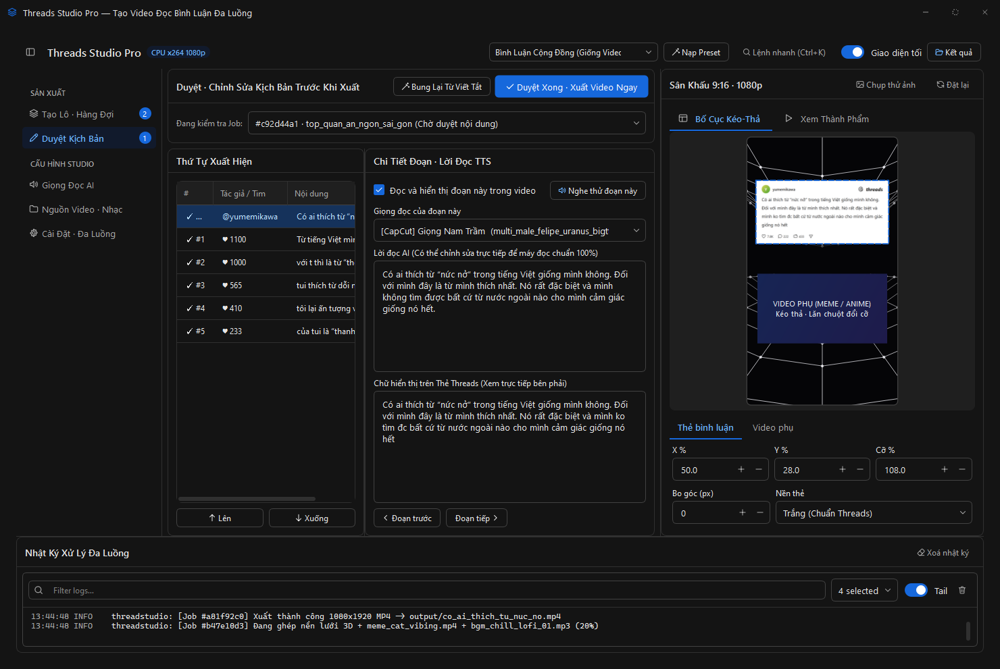
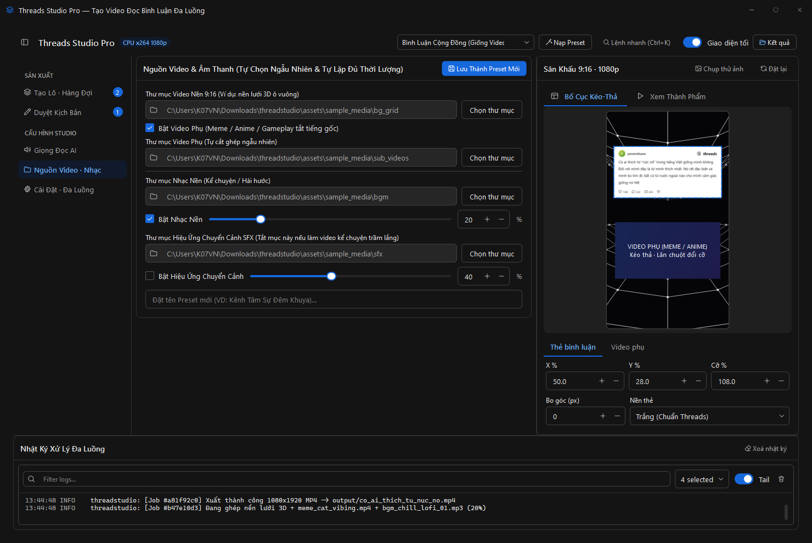
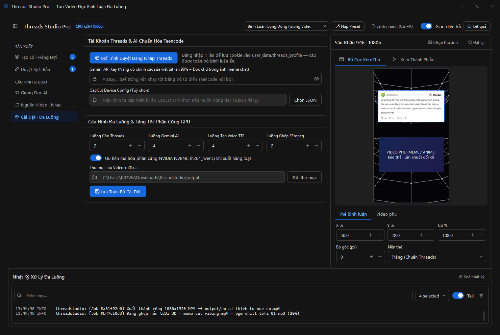
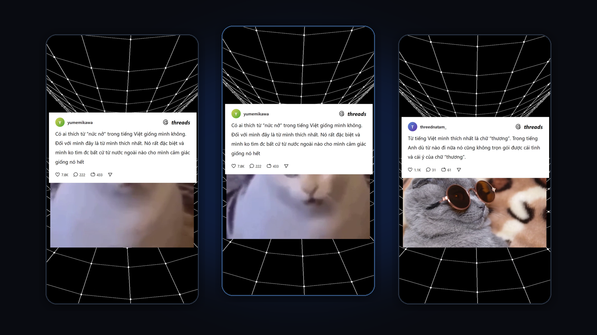

# Tính năng và giới hạn

| Tính năng hiện có | Nơi xử lý |
|---|---|
| Nhập lô URL hoặc kịch bản chia đoạn | UI, scraper/parser |
| Lọc bình luận theo tác giả/lượt thích và loại spam cơ bản | scraper |
| Bung viết tắt, xử lý tiếng lóng, đọc chữ trong ảnh | AI CLI |
| Chuẩn hóa bằng từ điển khi chọn Offline | AI |
| Duyệt, sửa lời đọc, bật/tắt và đổi thứ tự đoạn | Inspector |
| Chọn giọng đơn, ngẫu nhiên hoặc xoay vòng | TTS |
| CapCut, Edge, VieNeu và clone giọng khi có model/cấu hình | TTS |
| Kéo thẻ/video phụ, đổi theme thẻ, che tên, xem preview | UI/canvas/render |
| Chọn nguồn nền, video phụ, nhạc nền và SFX | cấu hình/media/render |
| Preset kênh và lưu preset mới | cấu hình/UI |
| Điều chỉnh worker từng tầng, ưu tiên NVENC | pipeline/render |
| Xuất MP4, timeline và các JSON trung gian | pipeline/render |

## AI nên dùng gì?

- Codex Luna: điểm bắt đầu tiết kiệm cho lời bình luận ngắn.
- Codex Sol hoặc Antigravity Hydrogen: thử khi ngữ cảnh/ảnh khó và kết quả model nhẹ chưa đạt.
- Antigravity Flash: lựa chọn ưu tiên tốc độ khi dịch vụ cho phép tài khoản sử dụng.
- Offline: không gọi model, không OCR; phù hợp khi chỉ cần từ điển cơ bản.

Đây là gợi ý theo loại công việc, không phải bảng đo chất lượng.
ComboBox cho nhập tên model khác; chọn tên không tự cấp quyền model đó.

## Giới hạn đã biết

- Scraping phụ thuộc DOM/SSR/GraphQL của Threads, cookie và nội dung trang tải được.
  Đăng nhập không bảo đảm đọc được mọi bình luận ẩn.
- OCR hiện chỉ gửi tối đa một ảnh của mỗi đoạn trong hai đoạn đầu;
  ảnh cần tồn tại và nhỏ hơn 3.500.000 byte.
- AI lỗi sẽ báo lỗi job; không âm thầm đổi sang từ điển offline.
- CLI dùng tài khoản/quota riêng; Plus không cấp quota Google.
- Hàng đợi nằm trong bộ nhớ; không có luồng khôi phục job từ JSON sau khi đóng app.
- Dừng job không phải cơ chế kill tức thì cho mọi CLI/TTS/FFmpeg.
- Nguồn TTS có fallback CapCut khi nguồn chọn lỗi; hoàn toàn offline không được bảo đảm.
- Antigravity CLI thay Gemini CLI; chỉ hiển thị model và đăng nhập của provider đang chọn.
- Số lượng voice/model thay đổi theo tài khoản và dịch vụ, không cố định theo README cũ.

## Ảnh minh họa giao diện

Ảnh có thể phản ánh phiên bản UI trước khi thay Gemini key bằng CLI.

